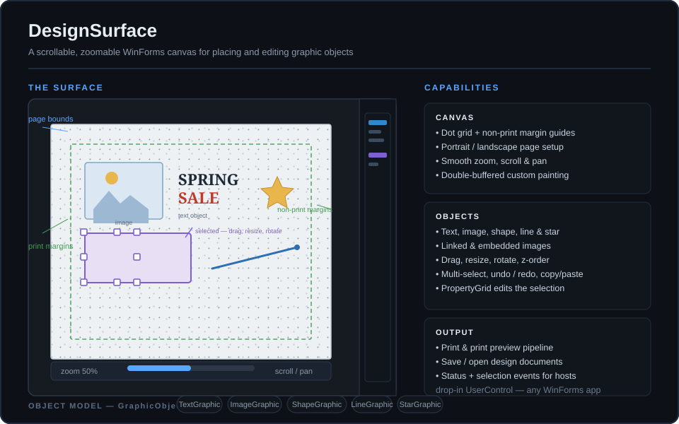

# DesignSurface - CSharp

A scrollable, zoomable **design surface** for WinForms — the canvas half of a
label/graphic designer — plus the **graphic object model** that draws on it.
Drop the `DesignSurface` control into any WinForms app and you get a page with
margins, a dot grid, object selection, undo/redo and a print pipeline, ready to
host text, images, shapes and more.

> **.NET 8+ edition:** [DesignSurface.NET](https://github.com/DwainSnickles/DesignSurface.NET) ports this codebase to modern .NET SDK-style projects.

<p align="center">
  <a href="https://www.nuget.org/packages/GraphicObjects/"></a>
  <a href="https://www.nuget.org/packages/GraphicsSurface/"></a>
</p>

<p align="center">
  
</p>

## Projects

| Project | Output | Purpose |
| --- | --- | --- |
| `GraphicObjects` | `GraphicObjects.dll` | The drawable object model — text, images, shapes, lines, stars — plus collection, history and filters. |
| `GraphicsSurface` | `GraphicsSurface.dll` | The `DesignSurface` UserControl: painting, input, selection, zoom, print and the PropertyGrid pane. |

`DesignSurface.slnx` contains both library projects — no sample apps.

## Capabilities

**Canvas**

- Printable page bounds with configurable portrait/landscape setup
- Non-printing margin guides and a configurable dot grid
- Smooth zoom, scroll and pan with double-buffered custom painting

**Objects**

- `TextGraphic`, `ImageGraphic` (linked + embedded), `ShapeGraphic`
  (rectangle, ellipse), `LineGraphic`, star and background-image objects
- Drag, resize and rotate with grab handles; click or rubber-band select
- Bring to front / send to back, undo & redo, cut/copy/paste
- Built-in `PropertyGrid` pane edits whichever object is selected

**Output**

- Print and print-preview pipeline honouring the page margins
- Save/open design documents and export the surface as an image
- `StatusUpdate` / `SelectionChanged` events so a host app can react

**Label & template import**

- `LabelSheet` presets covering most common **Avery** label/card/name-badge
  sheets (5160–5664 address & shipping, 5195–5395 specialty, 5305–5389 cards)
  — pick one from the `Template` property and the surface snaps objects to
  cell bounds via `GetTemplateCellBounds(col, row)`
- Import Office documents as templates: **`.docx` / `.dotx`** (Word) and
  **`.xlsx` / `.xlsm`** (Excel) — in code via `ImportTemplate()` or
  `ImportOfficeTemplate(path)`, or from the PropertyGrid's *Template*
  category using the `ImportWordTemplate` / `ImportSpreadsheet` commands
  (check the box to browse; they reset themselves)
- A uniform grid becomes the active `Template`; an irregular layout drops
  pinned guide rectangles (`IsPinned = true`) that can be selected but not
  moved, resized or rotated
- Office template import is **still in progress** — it handles common
  table/grid layouts, but some documents and files may not import correctly

## Usage

```csharp
var surface = new DesignSurface.DesignSurface
{
    Dock = DockStyle.Fill,
    PageSize = DesignSurface.PageSizeKind.Letter,
    Orientation = DesignSurface.GridOrientation.Portrait,
};

surface.drawingObjects.Add(new GraphicObjects.TextGraphic(
    new Point(100, 100), "Hello", new Font("Arial", 24), Color.Black));

surface.SelectionChanged += (s, e) => { /* react to selection */ };
surface.PrintPreview();
```

## Building

Open `GraphicsSurface/DesignSurface.slnx` in Visual Studio (2022 17.10+ or
VS 2026) — it builds both projects. Both target .NET Framework 4.8 and use
only framework assemblies, so the DLLs run on any Windows Forms app.

> **Note:** the object and surface namespaces are `GraphicObjects` and
> `DesignSurface` — the code was ported from the old
> `Microsoft.Msdn.Samples.*` VB sample, so expect names like
> `GraphicObjects.GraphicObjects` for the base object type.

## License

Derived from the Microsoft DesignSurface sample; see each project's
`AssemblyInfo` for origin notes.

---

<p align="center"><sub>Built for <a href="https://dwainsnickles.github.io/">Dwain Snickles</a> · used by <a href="https://github.com/DwainSnickles/GraphicsWorkshop">GraphicsWorkshop</a></sub></p>

## Support this project

If this project saved you some time, you can leave a tip at
[ko-fi.com/dwainhsnickles](https://ko-fi.com/dwainhsnickles) (cards, no account needed) or
[paypal.me/YTDPlatinum](https://paypal.me/YTDPlatinum). Bug reports and pull requests are welcome too.
